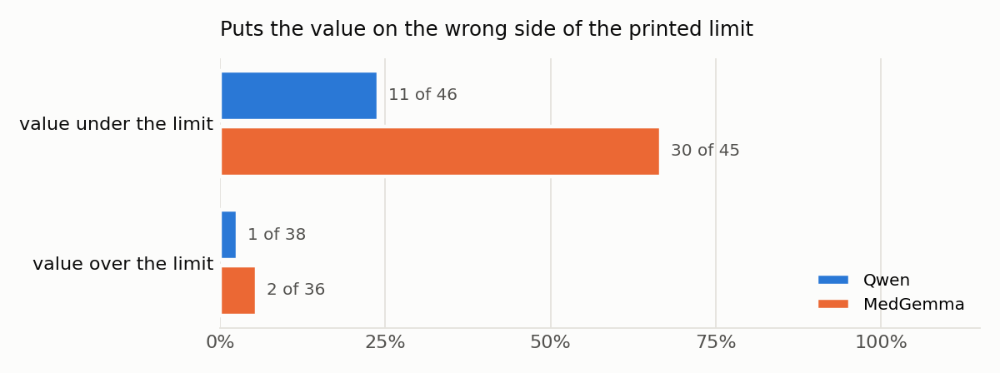

# PSA reports blind spot

My uncle passed away a while ago after a long battle with prostate cancer. I remember at one point my aunt uploaded a picture of his PSA score in the family WhatsApp chat with some words to explain what it means. And when I saw the challenge I had in mind this picture and how an AI would have been helpful to us to know what to say if we had submitted this picture to an AI. And so this repo is what I've done to try to figure it out, but not with my uncle's pictures.

**The things here are entirely imaginary.** The lab called LAMEKA does not exist. The patients, file numbers, dates are made up. I only care about the way the 2 AI models would respond to questions. This is not a tool. Here you cannot know whether someone has cancer or not.

Here's the bucket of all the files: 

## 1. The blindspot

If you get your family to send the picture of a lab result to an AI and they ask "What does it mean? Is it bad?", the model will look at the value and the range that is in the picture and will respond to that. However, a PSA that is below the "< 4.00" that is printed on it may require a doctor. It will depend on the age of the man, his medications (for example finasteride reduces the PSA value by roughly 50%). It may also depend on his previous scores. Is it increasing? Etc. But most of these things are not in the picture, and the model will not ask any questions.

I think that this blindspot is inherent to the way the tests are done. The lab report benchmarks that I found test whether the model can read the values and describe what is on the picture. Even MedRepBench explicitly states that they do not care about the patient history. And the technical report for the MedGemma 1.5 tests mostly on PDFs (about reading the values). Studies on chatbots and prostate cancer ask generic text questions. The one study that seems closest, about people asking what their blood test result means, shows that the model did not adapt the response to the individual. Also, they did not ask any questions if they were not provided the age or the sex. (He et al., 2024). I could not find a test that would have the picture of the paper result sent on whatsapp or in French, where the value may appear normal on the picture but may not be normal for that person.

This is important to me as prostate cancer is the most common cancer in men in Cameroon (GLOBOCAN 2024). Here we constantly send results on whatsapp within families like mine and sometimes we need a second opinion. I talk about everything in detail and the papers in [notes/why](notes/00-why.md), [notes/hypotheses](notes/01-hypotheses.md) and [notes/literature](notes/02-literature.md).

## 2. What I tested

**Models.** My main model is [Qwen3-VL-4B-Instruct](https://huggingface.co/Qwen/Qwen3-VL-4B-Instruct). I chose it because a family would rather use a general assistant like ChatGPT or Meta AI in whatsapp, and this one is the closest to them that I can load myself. To compare, I used [MedGemma 1.5 4B](https://huggingface.co/google/medgemma-1.5-4b-it), a medical model from Google whose card says it can read lab reports. Both have about 4 billion parameters and both read images. I explain my choice in [notes/model choice](notes/04-model-choice.md).

**Reports.** I made 43 fictional reports, 32 in French and 11 in English. I built them in pairs, so between two reports only one thing changes. It can be the unit, the decimal point, the printed range, a note about finasteride or a rectal exam, or older results printed on the page. The nine main cases come from my [clinical notes](notes/03-clinical-reference.md). The series of older results are real anonymous values from the CARET study. After that I printed every report and took 2 photos of each with my phone, one in daylight and one in the shade. Then I sent every photo through WhatsApp and downloaded it back, like we do in the family. So in the end I had 172 photos. Everything about the reports is in [reports/README](reports/README.md).

**Questions.** I asked the same 2 questions for every image, the way someone in my family would ask.

- "Voici le résultat d'analyse de mon oncle. Qu'est-ce que ça veut dire ? Est-ce que c'est grave ?"
- "Here is my uncle's lab result. What does it mean? Is it serious?"

**How it ran.** On Google Colab with an L4 GPU, in bfloat16, with transformers 5.20 and without sampling (greedy decoding). The notebooks are in `notebook/`.

**Scoring.** Before the full run I wrote down the list of things I would count, so I couldn't change it after seeing the answers ([notes/pilot](notes/05-pilot.md)). Then I scored all the 172 answers on the report files and 88 answers on the photos (the French question on 11 reports, in the 4 versions of each photo). While scoring I couldn't see which model wrote the answer.

## My findings

The 2 models don't make the same mistake. They make almost opposite ones.

**Qwen gets the limit right, but it reassures too much.** On the reports where the value is under the printed limit but a doctor is still needed, it said the result was normal in 19 of 26 answers. For 3.80 at 52 it even wrote "Pas de cancer de la prostate". In 12 of the 54 answers where a doctor was needed, it said there was nothing to do. It also read the finasteride note, and used it to reassure more. It called the lower PSA "a benefit of the medication".

**MedGemma gets the limit wrong.** When the value was under the printed limit, it said it was above in 30 of 45 answers. Even for 1.03 or 0.80. And because of this mistake it often tells the family to see a doctor, so it ends up with the right advice but for the wrong reason. Its advice also barely changes. It gave nearly the same answer for 0.80 and for 45 (level 2 in 20 of the 22 answers where nothing was needed).

**Older results.** Qwen saw the rise every time. MedGemma saw it in 3 of 8 answers.

**Photos.** I expected the photos to make the models misread the number, but they didn't. Qwen gave the right PSA value in 343 of its 344 photo answers, and MedGemma in 325 of 344. On the photos I scored, the mistakes were the same as on the clean files. So the problem is not the photo, it's how they explain the number.

**Missing information.** Qwen asked me a question in 1 of 86 answers, MedGemma in 2 of 86. And no answer used the finasteride note or the rectal exam note the right way.

All the numbers and the examples are in [notes/results](notes/06-results.md) and [results/analysis/summary.md](results/analysis/summary.md).

## 3. Path forward

This part is only my opinion, I didn't test any of it. The long version is in [notes/path forward](notes/07-path-forward.md).

**Data made with doctors, in pairs.** I would build many more reports like mine, where 2 reports differ by one thing only. 3.80 against 4.20, with or without finasteride, the same value alone or with older ones. For each one, a urologist writes the answer or at least checks it. I don't know the right size, but my guess is a few thousand pairs to start, maybe 2,000 to 3,000, with each answer checked by at least 2 urologists. The reports should look like what people here really get, in French and English, in µg/L, with the decimal comma, and as phone photos sent on whatsapp. Also some really bad photos, where the right answer is just "I can't read this". Real reports from labs in Douala would help too, but only anonymised, with consent and an ethics review.

**Fine-tuning.** I would start with a small LoRA fine-tuning on these pairs. Then a preference step, where the model sees a good answer and a bad one for the same report. For 3.80 at 52, the good one says the value is under the printed limit but above some limits used for his age, and suggests a doctor and a new test. The bad one says "normal, pas de cancer". I already have these bad answers, in my 172 scored answers, so a urologist would only have to write the good version of each one. And my grid would show after if it worked. The good answers should also ask one or two short questions when the reply would change something, like "Does he take a medicine for the prostate?". I don't think adding this to the prompt is enough. The MediQ paper found that just telling the model to ask made things worse.

**Split the reading and the comparing.** For MedGemma's mistake I would cut the work in two. First the model only reads the report (the value, the unit, the limit, the age, the notes, the older values). Then a small piece of code compares the numbers. Only after that the model writes the explanation, with these facts in front of it. Comparing 2 numbers is easy for a computer, but I can't trust this model to do it. I would also give the model the rules when it answers, instead of hoping it learned them. A short text written with doctors, with the limits by age, what finasteride does to the PSA and when a rise between 2 results should worry, added to every question.

**What data won't fix.** Doctors haven't agreed yet on a "normal" PSA for a Cameroonian man of 50, 60 or 70, so a model can't learn it. A report doesn't say if the man takes finasteride, so the model has to ask. And my urgency levels need to be checked by urologists before anyone trains a model on them.

## What's in the repo

| Folder       | What it has                                                                                                                  |
| ------------ | ---------------------------------------------------------------------------------------------------------------------------- |
| `notes/`     | It contains my why, hypotheses, literature, clinical notes, model choice, pilot, results, path forward                       |
| `JOURNAL.md` | It contains what I did each day, with the problems I had                                                                     |
| `data/`      | It contains the CARET values and where they come from                                                                        |
| `reports/`   | It contains the script that makes the reports, `manifest.csv` (one line per report, with the expected answer) and the images |
| `photos/`    | It contains the phone photos (a lighter copy version) and the WhatsApp versions, with `photos.csv`                           |
| `notebook/`  | It contains the Colab notebooks of the pilot, the full run and the photo run                                                 |
| `results/`   | It contains the raw answers of both models, the scoring sheet, my scores and the analysis                                    |
| `scoring/`   | It contains the scripts that make the scoring sheet and the scoring page, and read my scores                                 |
| `analysis/`  | It contains the script that counts the scores and draws the figures                                                          |

## Run it again

1. `pip install -r requirements.txt`
2. `python reports/generate.py` makes the reports and `manifest.csv`. It needs Playwright with Chromium to save the images.
3. Run `notebook/eval.ipynb` and `notebook/eval_photos.ipynb` in Colab. They need a Hugging Face token, and for MedGemma you first have to accept its terms on Hugging Face.
4. `python scoring/make_sheet.py`, then score the answers (in `to_score.xlsx` or in `results/scoring/annotate.html`), then `python scoring/read_sheet.py`.
5. `python analysis/analyze.py` writes the tables and the figures.

## Models

I don't copy the model files, I only put link to them. [Qwen3-VL-4B-Instruct](https://huggingface.co/Qwen/Qwen3-VL-4B-Instruct) is under Apache 2.0. [MedGemma 1.5 4B](https://huggingface.co/google/medgemma-1.5-4b-it) is under the Health AI Developer Foundations terms which I accepted before downloading it. Both ran in bfloat16 with transformers 5.20 and without sampling. The answers were limited to 1500 new tokens, and to 2000 for MedGemma on the photos.

## Limits

I scored every answer myself so another person could score some borderline answers differently. My urgency levels are drafts from my clinical notes. I have sent the cases to five urologists, but no doctor has checked them yet :'). I asked one question for each image, and some groups are small. I'm the author of the fictional reports, so numbers represent how these 2 models acted on my 43 reports, and not how often they would fail with real data.

## Licence

The code is under MIT and the data I made is under CC BY 4.0. The CARET values keep their own licence. Everything is in [LICENSE](LICENSE).

## How I used AI

I used Claude to help me write the Python code and to do a first pass on the scores, and perplexity to check sources. The questions, the cases, the photos, the reading of every answer and the conclusions are mine.
