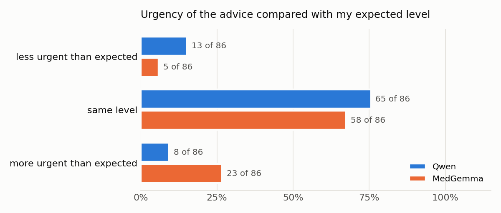

# Results

I scored the 172 answers on the report files and 88 answers on the photos, using the grid in [notes/pilot](05-pilot.md). The tables come from `analysis/analyze.py` and are all in [results/analysis/summary.md](../results/analysis/summary.md). I write the numbers as "x of n", with a percentage only when n is 20 or more, because with 4 or 8 answers a percentage looks more precise than it is.

Each model got 86 answers on files, because each of the 43 reports got my French and my English question.

## H1. Does it just repeat the printed limit?

The two models fail in opposite ways.

Qwen compares the value with the limit well when the value is over it, and most of the time when it is under it (it got 11 of 46 wrong). But on the reports where the value is under 4.00 and a doctor is still needed, like 3.80 at 52, the finasteride reports or the rising series, it called the result normal in 19 of 26 answers and gave a false reassurance in 17 of 26. So my first guess was right for Qwen. It reads "< 4.00", sees that the value is under, and stops there. On R001 it wrote "Pas de cancer de la prostate" and "Pas de problème à signaler" for 3.80 at 52 (F004).

It does use the age a lot (53 of 86 answers), and it picked the right row of the age table every time on R017 and R018. But it often uses the age to reassure. On the rising series at 60 it wrote "Cela est normal chez un homme de 60 ans, car le PSA peut augmenter avec l'âge" (F137).

MedGemma doesn't repeat the limit, it gets the comparison wrong. When the value is under the printed limit, it said it was above in 30 of 45 answers. It wrote things like "1,03 ng/mL, ce qui est supérieur à la valeur de référence de 4,00 ng/mL" (F104). When the value is over the limit, it was almost always right (2 of 36 wrong). The language of the question, the unit and the decimal point don't change much.

The strange part is that this mistake often brings MedGemma to the right level. On the reports where a doctor is needed with a value under the limit, 19 of its 26 answers asked for a doctor after saying the value was above the limit. The advice is right, but for the wrong reason.

## H2. Does the advice change with the value?

I didn't count "tells the family to see a doctor", because almost every answer in the pilot did it. What I checked is the urgency of the advice, with my three levels.

For Qwen, the level does follow the value. It gave level 1 in 21 of 22 answers where nothing was needed, and level 3 in 9 of 10 answers for a PSA of 45. Its problem is the middle. In 12 of 54 answers where I expected a doctor in the next weeks, it said there was nothing to do.

MedGemma is closer to what I guessed. It gave level 2 almost everywhere, in 20 of 22 answers where nothing was needed and in 5 of 10 answers for a PSA of 45. So a family gets nearly the same "consult your doctor" for 0.80 and for 45. Overall it was more urgent than my level in 23 of 86 answers, and less urgent in 5.

## H3. Does it see a rising series?

Here I was wrong for Qwen. It noticed the older values in every answer, the rise in 8 of 8 and the stable series in 4 of 4. One of the best answers of the whole study is on this case. It said "the trend of rising PSA over 3 years is not normal", sent him to a urologist and wrote "Don't wait" (F140). But in 2 of the 8 answers it saw the rise and still reassured, like "L'augmentation du PSA est due à l'âge et n'est pas un signe de cancer" (F137). F140 and F137 are the same report, one with the English question and one with the French one.

MedGemma saw the rise in only 3 of 8 answers and the stability in 1 of 4. Once it even read an older value as a second test (F167).

## H4. Do photos make it misread?

Mostly no. Qwen gave the right PSA value in 343 of its 344 photo answers, and MedGemma in 325 of 344. The answers without the value are mostly MedGemma refusing to explain in French, not misreading. Light, shade or WhatsApp didn't change this.

No model ever said the PSA value was hard to read. MedGemma said something was "not visible" in 8 answers, but each time it was about the line under the PSA, "Antigène prostatique spécifique", which it took for a second test without a value. So the second half of my guess is true, but there was nothing hard to read, so I can't say they would warn me on a really bad photo.

On the 11 reports I scored by hand on photos, the mistakes are the same as on the files. MedGemma put the value on the wrong side of the limit in 28 of 38 photo answers (7 of 11 on the files). Qwen reassured too much in 20 of 36 (5 of 9 on the files). The problem comes from how they explain the number, not from the photo.

## H5. Does it ask what is missing?

This guess was right for both models. Qwen asked me a real question in 1 of 86 answers and MedGemma in 2 of 86. No model used a clinical note well, 0 of 8 each.

With finasteride, Qwen read the note and then used it to reassure more. It wrote that the lower PSA is "actually a benefit of the medication" (F006). It gave level 1 on all 4 answers with the note, the same as on R019 where the note is missing. So the note changed nothing in its advice. With the rectal exam, Qwen made the exam the likely cause of the rise in 3 of its 4 answers, and MedGemma ignored the note every time.

## Other things I saw

Both models invent things, Qwen in 13 of 86 answers and MedGemma in 18 of 86. Some examples are a wrong conversion of urea to 280 mg/dL, a sample date called "in the future", a free PSA ratio explained the wrong way round, and PSA expanded as "Antigéné Protéine Sérotonique". No answer talked about a fake document, since I removed the "fictional" line after the pilot.

## What these results can't say

I scored every answer myself, alone, so another person could score some borderline answers differently. My levels are draft levels from my clinical notes, not checked by a doctor yet. Each question was asked once per report, and some groups are small (4 or 8 answers). The reports are fictional and made by me. So these numbers show how the two models behaved on my 43 reports, not how often they would fail with real families.
